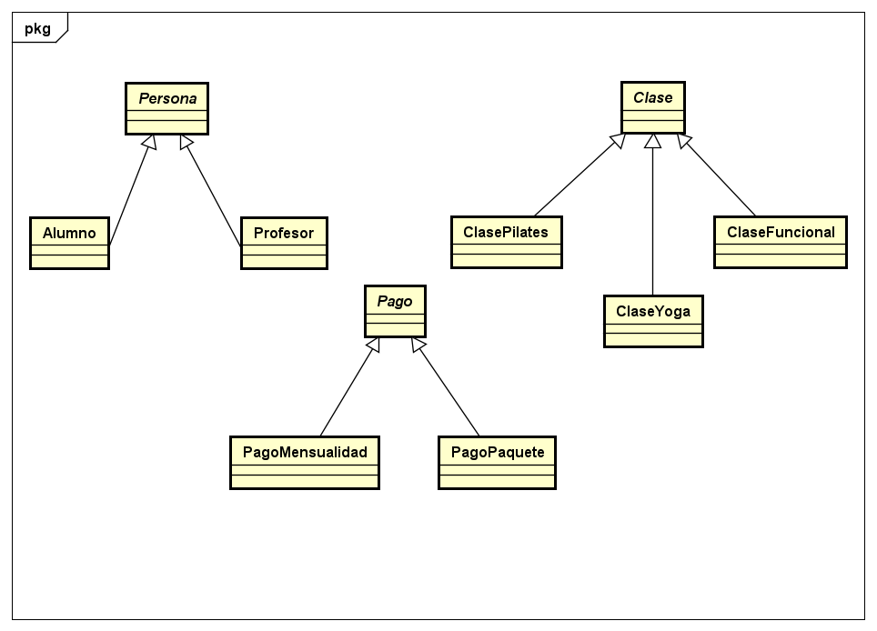
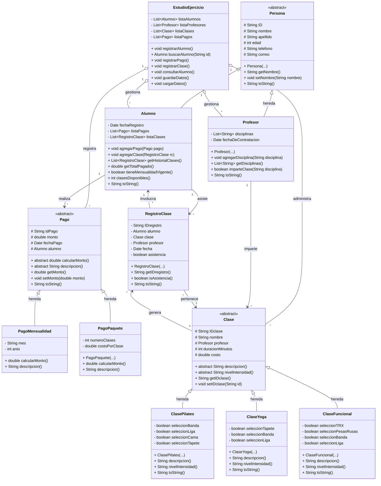

# PENDIENTE NOMBRE DEL PROYECTO

# 1. Identificación y justificación del problema

En los últimos años, los estudios enfocados en el bienestar físico y la salud mental, tales como centros de Yoga y Pilates, han experimentado un crecimiento constante en el número de alumnos e instructores. A pesar de este crecimiento y de la modernización de sus instalaciones, un número significativo de estos establecimientos continúa gestionando sus operaciones administrativas de manera completamente manual, utilizando libretas de papel y registros físicos en recepción.

El uso de registros manuales en la recepción para controlar el funcionamiento diario del estudio conlleva diversas limitaciones y riesgos operativos como: riesgo de pérdida o traspapelación, ineficiencia en la gestión de asistencias y paquetes de clases y falta de control financiero.

Para abordar las deficiencias del control manual, se propone el desarrollo de un Sistema de Gestión para Estudio de Yoga y Pilates implementado bajo el paradigma de Programación Orientada a Objetos en Java.

La optimización de estos procesos mediante este software permitirá:

- **Digitalizar y centralizar los datos:** Registrar de forma organizada a los alumnos, paquetes de clases, mensualidades y asistencias en el sistema.
- **Optimizar el trabajo operativo:** Reducir significativamente el tiempo y esfuerzo que las recepcionistas invierten en tareas administrativas repetitivas.
- **Aumentar la confiabilidad:** Minimizar las confusiones y la pérdida de datos, garantizando un control preciso de la vigencia de los paquetes y los pagos de los alumnos.
- **Facilitar la interacción:** Proporcionar una interfaz gráfica amigable e intuitiva mediante elementos visuales (menús, botones y formularios) para agilizar la atención en recepción.
# 2. Análisis del problema
## 2.1 Descripción general del problema

Los estudios de Yoga y Pilates gestionan a sus alumnos, pagos y asistencias con libretas de papel y registros físicos en recepción. Esto genera riesgo de pérdida o traspapelación de datos, dificultad para saber si un alumno tiene una mensualidad o un paquete de clases vigente, y falta de control sobre los pagos realizados y las clases tomadas.

El sistema propuesto digitaliza estas operaciones mediante un menú dinámico en el que la recepcionista puede registrar alumnos y profesores, consultar sus datos, asignarles un tipo de pago (mensualidad o paquete de clases) y llevar el registro de las clases que han tomado.

## 2.2 Alcance del sistema

**El sistema incluye:**

- Registro de alumnos con sus datos personales.
- Consulta de la información de los alumnos registrados.
- Registro de profesores con sus datos personales y las disciplinas que imparten.
- Consulta de la información de los profesores registrados.
- Asignación y control del tipo de pago: mensualidad o paquete de clases.
- Registro de las clases tomadas por cada alumno, indicando el tipo de clase (Yoga, Pilates, Funcional, etc.) y el profesor que la impartió.
- Validación de la vigencia de la mensualidad o de las clases disponibles en el paquete.
- Interfaz gráfica con menús, botones y formularios.

**El sistema no incluye (fuera de alcance de esta versión):**

- Pagos en línea ni integración con terminales bancarias.
- Reservación de clases desde una aplicación móvil o sitio web.
- Nómina, pagos o control de horarios laborales de los profesores.
- Contabilidad formal ni facturación.

## 2.3 Usuarios del sistema

| Usuario | Descripción | Interacción con el sistema |
|---|---|---|
| Recepcionista | Persona que atiende a los alumnos en recepción. Es el usuario principal. | Registra alumnos, consulta datos, asigna pagos y registra clases tomadas. |
| Administrador | Encargado o dueño del estudio. | Consulta información general y reportes. |

## 2.4 Entradas

Son los datos que el usuario debe proporcionar al sistema.

| Módulo | Entradas |
|---|---|
| Registro de alumno | Nombre completo, edad o fecha de nacimiento, teléfono, correo electrónico, contacto de emergencia, fecha de inscripción. |
| Registro de profesor | Nombre completo, teléfono, correo electrónico, disciplinas que imparte (Yoga, Pilates, Funcional, etc.), fecha de ingreso. |
| Tipo de pago | Alumno al que se asigna, tipo de pago (mensualidad o paquete de clases), monto pagado, fecha de pago. Si es paquete: número de clases adquiridas. Si es mensualidad: mes que se cubre. |
| Registro de clase tomada | Alumno, tipo de clase (Yoga, Pilates, Funcional, etc.), fecha y hora de la clase, profesor que la imparte (seleccionado entre los profesores registrados). |
| Consulta de alumnos y profesores | Criterio de búsqueda: nombre o identificador del alumno o del profesor. |
| Navegación | Opción elegida en el menú principal. |

## 2.5 Procesos

Son las operaciones que el sistema realiza con las entradas.

1. **Registrar alumno:** validar que los datos obligatorios estén completos, asignar un identificador único y almacenar al alumno en el sistema.
2. **Consultar alumno:** buscar al alumno por nombre o identificador y recuperar su información, su pago actual y su historial de clases.
3. **Registrar profesor:** validar que los datos obligatorios estén completos, asignar un identificador único y almacenar al profesor en el sistema junto con las disciplinas que imparte.
4. **Consultar profesor:** buscar al profesor por nombre o identificador y recuperar su información y las clases que ha impartido.
5. **Asignar tipo de pago:**
   - Si es **mensualidad**: calcular la fecha de inicio y la fecha de vencimiento (por ejemplo, un mes después del pago).
   - Si es **paquete de clases**: establecer el número de clases disponibles y su fecha de vigencia.
6. **Verificar vigencia:** antes de registrar una clase, comprobar que la mensualidad no haya vencido o que el paquete aún tenga clases disponibles.
7. **Registrar clase tomada:** validar que el profesor esté registrado e imparta esa disciplina, y guardar la asistencia con su tipo de clase, profesor y fecha; si el pago es por paquete, descontar una clase del saldo.
8. **Calcular el estado de cuenta del alumno:** determinar clases restantes, días para el vencimiento o si el pago está vencido.
9. **Mostrar el menú dinámico:** presentar las opciones disponibles y dirigir al usuario a la función seleccionada.

## 2.6 Salidas

Son los resultados que el sistema entrega al usuario.

| Proceso | Salidas |
|---|---|
| Registrar alumno | Mensaje de confirmación y número de identificación asignado. |
| Consultar alumno | Ficha del alumno con datos personales, tipo de pago activo, vigencia o clases restantes e historial de clases tomadas. |
| Registrar profesor | Mensaje de confirmación y número de identificación asignado al profesor. |
| Consultar profesor | Ficha del profesor con datos personales, disciplinas que imparte e historial de clases impartidas. |
| Asignar tipo de pago | Confirmación del pago, fecha de vencimiento o número de clases disponibles. |
| Registrar clase | Confirmación de asistencia con el profesor asignado y saldo actualizado (clases restantes). |
| Verificación de vigencia | Aviso de pago vencido o de paquete agotado, cuando aplique. |
| Validaciones | Mensajes de error claros (campos vacíos, alumno o profesor no encontrado, datos inválidos). |

## 2.7 Resumen entradas, procesos y salidas

| Entradas | Procesos | Salidas |
|---|---|---|
| Datos personales del alumno | Validar y registrar alumno | Confirmación e identificador del alumno |
| Datos personales y disciplinas del profesor | Validar y registrar profesor | Confirmación e identificador del profesor |
| Nombre o identificador a buscar | Buscar y recuperar información | Ficha completa del alumno o del profesor |
| Tipo de pago, monto y fecha | Asignar pago y calcular vigencia o clases | Confirmación de pago y vigencia |
| Alumno, tipo de clase, profesor y fecha | Verificar vigencia y registrar asistencia | Confirmación y saldo actualizado |
| Opción del menú | Dirigir a la función seleccionada | Pantalla o formulario correspondiente |

## 2.8 Requisitos funcionales

| Clave | Requisito |
|---|---|
| RF-01 | El sistema debe mostrar un menú principal con las opciones: registrar alumno, consultar alumnos, registrar profesor, consultar profesores, asignar tipo de pago y registrar clase tomada. |
| RF-02 | El sistema debe permitir registrar un alumno con sus datos personales y asignarle un identificador único. |
| RF-03 | El sistema debe validar que los campos obligatorios del alumno no estén vacíos y que tengan un formato válido (por ejemplo, teléfono numérico). |
| RF-04 | El sistema debe permitir consultar los datos de un alumno por nombre o identificador. |
| RF-05 | El sistema debe permitir mostrar la lista de todos los alumnos registrados. |
| RF-06 | El sistema debe permitir asignar a un alumno un tipo de pago: mensualidad o paquete de clases. |
| RF-07 | Para una mensualidad, el sistema debe calcular y mostrar la fecha de vencimiento. |
| RF-08 | Para un paquete de clases, el sistema debe registrar el número de clases adquiridas y mantener el saldo de clases restantes. |
| RF-09 | El sistema debe permitir registrar las clases tomadas por un alumno, indicando el tipo de clase (Yoga, Pilates, Funcional, etc.) y la fecha. |
| RF-10 | Al registrar una clase, el sistema debe verificar que el pago del alumno esté vigente; en caso contrario debe notificarlo y no registrar la asistencia. |
| RF-11 | Cuando el pago sea un paquete, el sistema debe descontar una clase del saldo por cada asistencia registrada. |
| RF-12 | El sistema debe mostrar el historial de clases tomadas por cada alumno. |
| RF-13 | El sistema debe permitir agregar nuevos tipos de clase sin modificar el resto del programa. |
| RF-14 | El sistema debe mostrar mensajes claros de confirmación y de error. |
| RF-15 | El sistema debe permitir registrar un profesor con sus datos personales y las disciplinas que imparte, asignándole un identificador único. |
| RF-16 | El sistema debe validar que los campos obligatorios del profesor no estén vacíos y que tengan un formato válido. |
| RF-17 | El sistema debe permitir consultar los datos de un profesor por nombre o identificador y mostrar la lista de todos los profesores registrados. |
| RF-18 | Al registrar una clase tomada, el sistema debe asociarla a un profesor registrado que imparta esa disciplina. |
| RF-19 | El sistema debe mostrar el historial de clases impartidas por cada profesor. |

## 2.9 Requisitos no funcionales

| Clave | Categoría | Requisito |
|---|---|---|
| RNF-01 | Usabilidad | La interfaz gráfica debe ser intuitiva, con menús, botones y formularios que una recepcionista sin conocimientos técnicos pueda usar. |
| RNF-02 | Confiabilidad | Los datos de alumnos, pagos y asistencias no deben perderse al cerrar el programa (almacenamiento persistente en archivo). |
| RNF-03 | Rendimiento | Las consultas y registros deben responder de forma casi inmediata para agilizar la atención en recepción. |
| RNF-04 | Mantenibilidad | El código debe seguir el paradigma orientado a objetos (clases, encapsulamiento, herencia, polimorfismo e interfaces) para facilitar su ampliación. |
| RNF-05 | Portabilidad | El sistema debe desarrollarse en Java para ejecutarse en cualquier equipo con la máquina virtual de Java instalada. |
| RNF-06 | Integridad | El sistema debe evitar datos inconsistentes mediante validaciones (por ejemplo, saldo de clases negativo). |

## 2.9 Casos de uso principales

| Caso de uso | Actor | Descripción breve |
|---|---|---|
| CU-01 Registrar alumno | Recepcionista | Captura y guarda los datos de un nuevo alumno. |
| CU-02 Consultar alumno | Recepcionista | Busca un alumno y muestra su ficha, pago e historial. |
| CU-03 Asignar tipo de pago | Recepcionista | Registra una mensualidad o paquete de clases para un alumno. |
| CU-04 Registrar clase tomada | Recepcionista | Anota la asistencia a una clase con su profesor, tras verificar vigencia. |
| CU-05 Registrar profesor | Recepcionista / Administrador | Captura y guarda los datos de un nuevo profesor. |
| CU-06 Consultar profesor | Recepcionista / Administrador | Busca un profesor y muestra su ficha y clases impartidas. |

## OJOOOO
Del análisis se identifican de forma preliminar los conceptos principales del problema, que serán la base para la identificación de clases en el siguiente punto:

- **Alumno:** persona inscrita en el estudio.
- **Profesor:** persona que imparte las clases. Alumno y profesor comparten datos básicos (nombre, teléfono, correo), lo que sugiere una clase general **Persona** de la que ambos hereden.
- **Tipo de pago:** concepto general con dos variantes, mensualidad y paquete de clases, que comparten datos (monto, fecha de pago) pero se comportan distinto al validar vigencia. Esto sugiere el uso de **herencia y polimorfismo**.
- **Tipo de clase:** concepto general con variantes (Yoga, Pilates, Funcional, etc.), que también permite aplicar herencia y polimorfismo.
- **Registro de clase (asistencia):** relaciona a un alumno con una clase tomada en una fecha determinada.

# 3. Aproximación a una solución software.
---
# a) 

1. **Clase abstracta Persona**

Atributos:

· ID
· nombre
· apellido
· edad
· telefono
· correo

Métodos:

· Constructores
· Getters y setters
· toString()

---

2. **Clase Alumno** (hereda de Persona)

Atributos:

· fechaRegistro
· listaPagos
· listaClases

Métodos:

· agregarPago()
· agregarClase()
· getHistorialClases()
· getTotalPagado()
· tieneMensualidadVigente()
· clasesDisponibles()
· toString()
· Getters y setters

---

3. **Clase Profesor** (hereda de Persona)

Atributos:

· disciplinas
· fechaDeContratacion

Métodos:

· Constructor
· agregarDisciplina()
· getDisciplinas()
· imparteClase()
· Getters y setters
· toString()

---

4. **Clase abstracta Pago**

Atributos:

· idPago
· monto
· fechaPago
· alumno

Métodos:

· Abstractos: calcularMonto(), descripcion()

. Concretos: getters y setters, toString()

---

5. **Clase PagoMensualidad** (hereda de Pago)

Atributos:

· mes
· anio

Métodos:

· calcularMonto()
· descripcion()

---

6. **Clase PagoPaquete** (hereda de Pago)

Atributos:

· numeroClases
· costoPorClase

Métodos:

· Constructor
· calcularMonto() (numeroClases * costoPorClase)
· descripcion()

---

7. **Clase abstracta Clase**

Atributos:

· IDclase
· nombre
· profesor
· duracionMinutos
· costo

Métodos:

· Abstractos: descripcion(), nivelIntensidad()
· Concretos: getters y setters

---

8. **Clase ClasePilates** (hereda de Clase)

Atributos:

· seleccionBanda (boolean)
· seleccionLiga (boolean)
· seleccionCama (boolean)
· seleccionTapete (boolean)

Métodos:

· Constructor
· descripcion()
· nivelIntensidad()
· Getters y setters
· toString()

---

9. **Clase ClaseYoga** (hereda de Clase)

Atributos:

· seleccionTapete (boolean)
· seleccionBanda (boolean)
· seleccionLiga (boolean)

Métodos:

· Constructor
· descripcion()
· nivelIntensidad()
· Getters y setters
· toString()

---

10. **Clase ClaseFuncional** (hereda de Clase)

Atributos:

· seleccionTRX (boolean)
· seleccionPesasRusas (boolean)
· seleccionBanda (boolean)
· seleccionLiga (boolean)

Métodos:

· Constructor
· descripcion()
· nivelIntensidad()
· Getters y setters
· toString()

---

11. **Clase RegistroClase**

Atributos:

· IDregistro
· alumno
· clase
· profesor
· fecha
· asistencia

Métodos:

· Constructor
· Getters y setters
· toString()

---

12. **Clase EstudioEjercicio**

Atributos:

· listaAlumnos
· listaClases
· listaPagos

Métodos:

· registrarAlumno()
· buscarAlumno()
· registrarPago()
· registrarClase()
· consultarAlumno()
· guardarDatos()
· cargarDatos()

---

13. **Mainclass ProbarStudio**

Métodos:

· main(String[] args)

---
# b) Diagramas UML

### Diagrama de jerarquía de clases

---

### Diagrama de clases detallado

# Implementación de herencia, polimorfismo e interfaces

En el desarrollo del Sistema de Gestión para el Estudio de Yoga y Pilates, el diseño orientado a objetos se sustenta en tres pilares fundamentales de la POO: Herencia, Polimorfismo e Interfaces. Estos conceptos no solo permiten una estructura de código limpia y organizada, sino que garantizan la mantenibilidad y escalabilidad del software conforme a los requisitos no funcionales (RNF-04).

A continuación se detalla dónde y cómo se implementarán cada uno de estos temas basándonos en la arquitectura de clases definida en la solución.

---

## 4.1 Herencia

La herencia se utilizará para evitar la duplicación de código (principio DRY - Don't Repeat Yourself), permitiendo que las clases hijas reutilicen los atributos y métodos comunes definidos en una clase superior (superclase), añadiendo o especializando su propio comportamiento.

### 1. Jerarquía de Personas (Persona -> Alumno, Profesor)
* **Superclase:** Persona (Clase abstracta)
  * *Atributos heredables:* id, nombre, apellido, edad, telefono, correo.
* **Subclases:** Alumno y Profesor
  * *Especialización en Alumno:* Añade atributos y métodos propios de su rol, como fechaRegistro, listaPagos, listaClases, además de métodos como agregarPago() y tieneMensualidadVigente().
  * *Especialización en Profesor:* Añade atributos específicos de su labor docente, tales como disciplinas (lista de disciplinas que imparte) y fechaDeContratacion, junto con métodos como imparteClase().

### 2. Jerarquía de Pagos (Pago -> PagoMensualidad, PagoPaquete)
* **Superclase:** Pago (Clase abstracta)
  * *Atributos heredables:* idPago, monto, fechaPago, alumno.
* **Subclases:** PagoMensualidad y PagoPaquete
  * *Especialización en PagoMensualidad:* Incorpora los atributos mes y anio para controlar el periodo cubierto.
  * *Especialización en PagoPaquete:* Incorpora los atributos numeroClases y costoPorClase para gestionar el saldo de asistencias disponibles.

### 3. Jerarquía de Clases / Disciplinas (Clase -> ClasePilates, ClaseYoga, ClaseFuncional)
* **Superclase:** Clase (Clase abstracta)
  * *Atributos heredables:* IDclase, nombre, profesor, duracionMinutos, costo.
* **Subclases:** ClasePilates, ClaseYoga, ClaseFuncional
  * *Especialización:* Cada una incluye atributos propios de los aditamentos o equipos específicos que se utilizan en la disciplina (por ejemplo, seleccionCama, seleccionTapete en Pilates; seleccionBanda, seleccionLiga en Yoga; o seleccionTRX, seleccionPesasRusas en Funcional).

---

## 4.2 Polimorfismo

El polimorfismo se aplicará principalmente mediante la sobreescritura de métodos (Method Overriding) a partir de las clases abstractas. Esto permite que el sistema trate a diferentes objetos de manera uniforme a través de sus referencias generales, ejecutando el comportamiento específico correspondiente a cada tipo de objeto en tiempo de ejecución.

### 1. Polimorfismo en el Cálculo de Pagos (Pago)
* **Implementación:** La clase abstracta Pago declara el método abstracto calcularMonto() y descripcion().
* **Comportamiento:**
  * En PagoMensualidad, el método calcularMonto() asigna y retorna la tarifa fija establecida por la mensualidad del estudio.
  * En PagoPaquete, el método calcularMonto() multiplica de forma dinámica numeroClases * costoPorClase.
* **Ventaja en el sistema:** Al momento de generar un reporte financiero o consultar los pagos de un alumno, el sistema puede invocar pago.calcularMonto() u obtener la descripción sin necesidad de evaluar explícitamente si se trata de un paquete o una mensualidad, facilitando la extensibilidad si en el futuro se desea agregar un nuevo tipo de pago (por ejemplo, "Clase suelta").

### 2. Polimorfismo en las Disciplinas del Estudio (Clase)
* **Implementación:** La clase abstracta Clase define los métodos abstractos descripcion() y nivelIntensidad().
* **Comportamiento:** Cada subclase (ClaseYoga, ClasePilates, ClaseFuncional) sobrescribe estos métodos para retornar los detalles particulares de la disciplina y su nivel de exigencia física.
* **Ventaja en el sistema:** Satisface directamente el Requisito Funcional RF-13 ("El sistema debe permitir agregar nuevos tipos de clase sin modificar el resto del programa"), ya que el módulo de registro de clases interactúa genéricamente con la clase abstracta Clase.

---

## 4.3 Interfaces

Las interfaces se incorporarán para definir contratos de comportamiento estrictos que ciertas clases deben cumplir, garantizando desacoplamiento y estandarización en áreas críticas como el almacenamiento persistente de datos y la validación de reglas de negocio.

### 1. Interfaz Persistible
* **Propósito:** Definir el contrato para aquellas clases o gestores que necesiten almacenar y recuperar información desde archivos de texto o binarios para cumplir con el Requisito No Funcional RNF-02 (Confiabilidad / Almacenamiento persistente).
* **Métodos definidos en el contrato:**
  * void guardarDatos(String rutaArchivo);
  * void cargarDatos(String rutaArchivo);
* **Implementación:** La clase principal EstudioEjercicio implementará esta interfaz, asegurando que los registros de alumnos, profesores y pagos no se pierdan al cerrar el sistema.

### 2. Interfaz Validable
* **Propósito:** Estandarizar los mecanismos de validación de vigencias y estados antes de permitir registrar una asistencia o aplicar un pago (Requisito Funcional RF-10 y RF-16).
* **Métodos definidos en el contrato:**
  * boolean validarVigencia();
* **Implementación:** Las clases asociadas al control de asistencias y los tipos de pago implementarán esta interfaz para verificar de manera uniforme si un paquete de clases se ha agotado o si una mensualidad ha expirado antes de autorizar el acceso a la clase en recepción.

